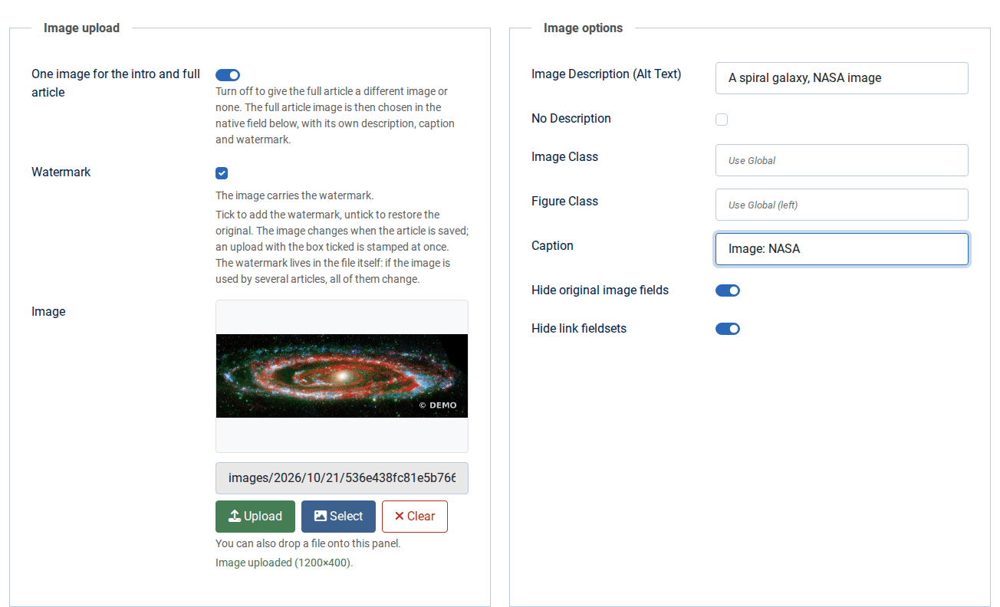
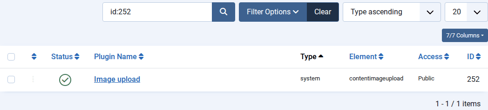
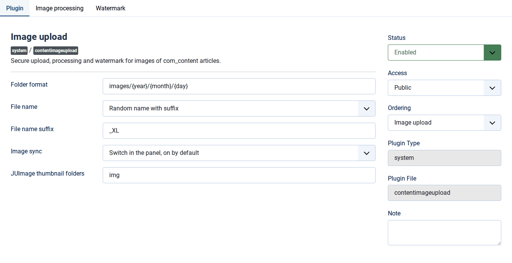
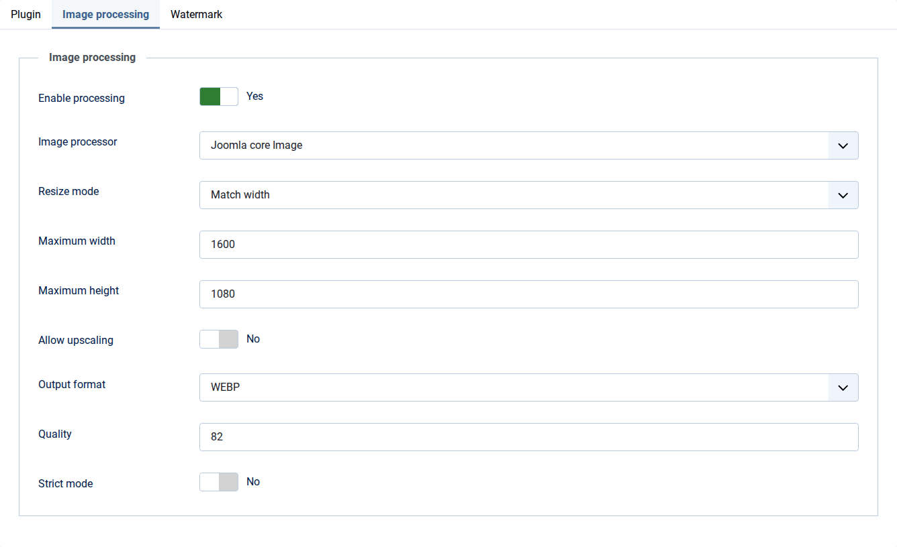
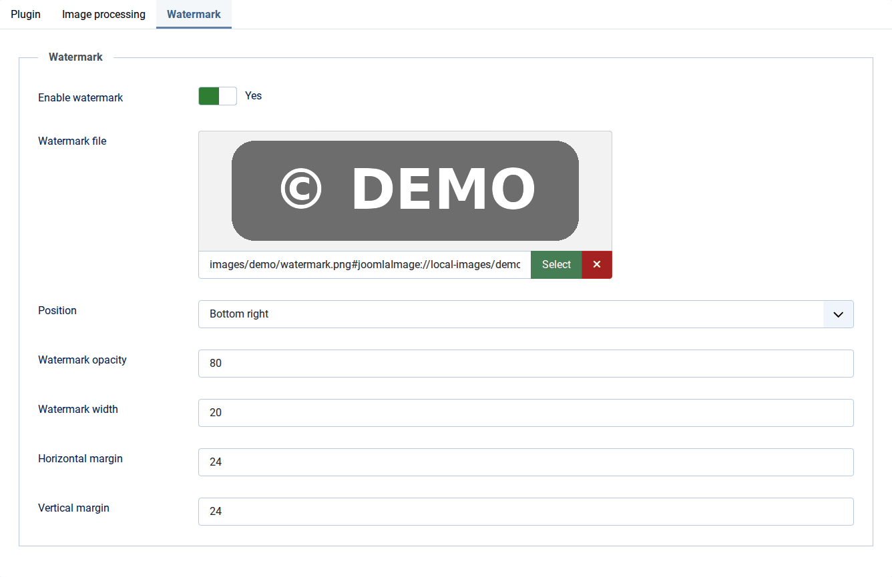
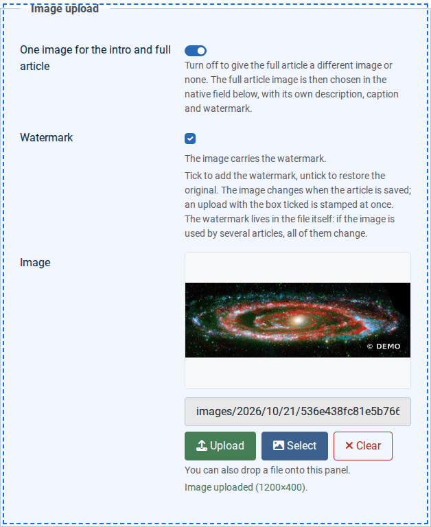
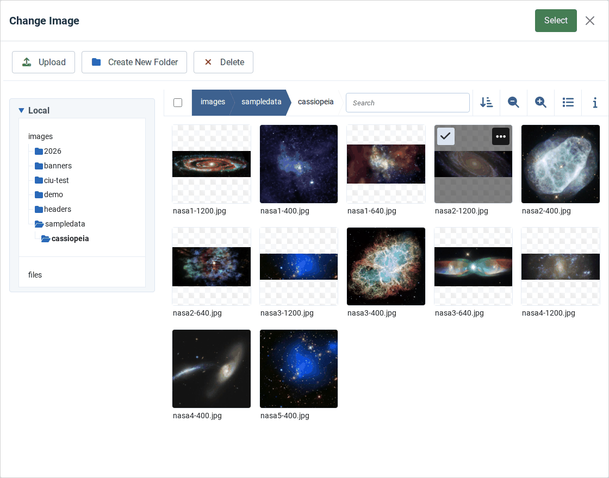
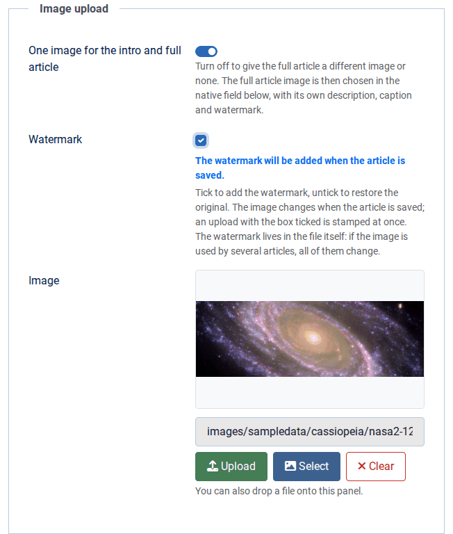

# Content Image Upload

[Русский](README.md) · [Қазақша](README.kk.md) · **English**

A Joomla 6 system plugin for the article editor. It adds a panel to the "Images and Links" tab: upload an image with a button or by dragging a file onto the panel, pick one from the Media Manager, shrink it, convert it to WebP or AVIF and, if needed, stamp a watermark that can be taken off later. One image becomes both the intro and the full article image at once; when the full article needs its own, one switch turns the sync off.



Version 2.0.1 · Joomla 6.0 or later · PHP 8.3 or later with GD · GNU GPL 2 or later

Download: [GitHub releases](https://github.com/bsakhanov/plg_system_contentimageupload/releases) · author: Beibit Sakhanov, [webmarka.kz](https://webmarka.kz)

## Contents

- [Features](#features)
- [Requirements](#requirements)
- [Installation and updates](#installation-and-updates)
- [Settings](#settings)
- [Working in the editor](#working-in-the-editor)
- [How an upload works](#how-an-upload-works)
- [Ways to insert an image](#ways-to-insert-an-image)
- [How it differs from the Media Manager](#how-it-differs-from-the-media-manager)
- [JUImage and the wmarka template](#juimage-and-the-wmarka-template)
- [Where the originals live](#where-the-originals-live)
- [Checks and security](#checks-and-security)
- [Questions and answers](#questions-and-answers)
- [Inside the plugin](#inside-the-plugin)
- [Authorship and license](#authorship-and-license)

## Features

- Upload with one click or by dropping a file onto the panel, without reloading the page.
- A folder from a template with variables, such as `images/2026/10/21`; the date follows the user's time zone.
- A unique file name: random, date-based or a transliteration of the original; Russian and Kazakh Cyrillic becomes Latin.
- Processing on upload: five resize modes, conversion to WebP, AVIF, JPG and other formats, quality, and rotation of phone photos by their EXIF tag.
- One image for the intro and full article, or two different ones — the editor decides with a switch.
- A watermark that can be removed: the plugin keeps the original before stamping.
- Field values in the same form Joomla writes itself, so `` on the site gets `width`, `height` and `loading="lazy"`.
- JUImage thumbnails are refreshed after a watermark change, so the wmarka template shows the new picture at once.
- Interface in Russian, Kazakh and English.

## Requirements

- Joomla 6.0 or later.
- PHP 8.3 or later with the GD extension. WebP and AVIF need a GD build that supports them; rotating phone photos needs the `exif` extension.
- User permissions: "Create" in the Media Manager to upload, "Create" or "Edit" for the watermark, plus permissions on the article itself.

## Installation and updates

1. Open "System → Install → Extensions", the "Upload Package File" tab, and drop `plg_system_contentimageupload-2.0.1.zip` there. From the command line the same is done by

   ```
   php cli/joomla.php extension:install --path=plg_system_contentimageupload-2.0.1.zip
   ```

2. After the first installation the plugin is disabled. Open "System → Plugins", find "Image upload" and enable it.

   

3. Open the plugin and go through the three settings tabs (see "Settings"). If you need a watermark, enable it and choose the watermark file.

If you prefer working with files, take `plg_system_contentimageupload-2.0.1-site-root.zip` from the release: it unpacks straight into the site root, after which "System → Install → Discover" finds the plugin and registers it.

Updates come through Joomla: the plugin is connected to the update server in this repository, and a new version shows up among the available extension updates. A manual update is installed over the previous version the same way; settings are kept. Originals that version 1.6 kept in the administrator cache are moved to the new store automatically the first time the image is touched.

Uninstalling the plugin leaves the `images/.contentimageupload` folder with the originals in place: it is site data, not plugin files.

## Settings

### The "Plugin" tab: basic settings



| Setting | Default | What it does |
|---|---|---|
| Folder format | `images/{year}/{month}/{day}` | The folder template for uploads. The path starts with `images/`; going up (`..`) is not allowed. Variables: `{user_id}` — user ID, `{year}`, `{month}`, `{day}`, `{week_year}` — week of the year, `{week_day}` — day of the week from zero, `{day_year}` — day of the year from zero, `{hours}` — 12-hour clock, `{hours_24}`, `{minutes}`, `{seconds}`, `{unix}` — UNIX time. Example: `images/{user_id}/{year}-{month}-{day}`. |
| File name | "Random name with suffix" | "Random name with suffix" gives `2e27f9637dce51e6669b3ef745d393d6_xl-5269a2bed740ef54.jpg`, "Date + hash" gives `20261021_143005_9f2c1e0a5b7d4c3e-5269a2bed740ef54.jpg`, "Transliterated original name" turns "Фото репортаж.jpg" into `foto-reportazh-5269a2bed740ef54.jpg`. Every name gets a random 16-character tail, so an existing file is never overwritten. |
| File name suffix | `_XL` | Random names only; written in lowercase Latin, so `_XL` becomes `_xl`. |
| Image sync | "Switch in the panel, on by default" | "Always, no switch" keeps one image in both fields. The other two modes put a switch in the panel and set its starting position for a new article. See "One image or two". |
| JUImage thumbnail folders | `img` | Folders, relative to the site root and comma-separated, where the template keeps JUImage thumbnails; `img` for wmarka. After adding or removing a watermark the plugin deletes the thumbnails of that image there. An empty field turns the cleanup off; the `images` folder is not accepted. |

### The "Image processing" tab

The screenshot shows an example: images are shrunk to 1600 pixels wide and converted to WebP.



| Setting | Default | What it does |
|---|---|---|
| Enable processing | yes | While on, the file is always re-encoded on upload, even when size and format stay: that is how a photo gets rotated by EXIF and loses its metadata (camera model, date, GPS coordinates). Turn it off to store the file byte for byte. |
| Image processor | Joomla core Image | The only option: the `Joomla\CMS\Image\Image` class on top of GD. |
| Resize mode | "Do not resize" | "Fit inside bounds" puts the whole image into a "maximum width × maximum height" frame and fills the empty margins with a colour. "Crop to exact size" fills the frame and cuts off the rest around the centre. "Match width" sets the width to the maximum and keeps the proportions; "Match height" does the same for the height. |
| Maximum width, maximum height | 1920 and 1080 pixels | Bounds for the resize modes; 0 removes the limit on that side. |
| Image fill color | `#ffffff` | Margin colour for "Fit inside bounds". |
| Allow upscaling | no | Allows enlarging images smaller than the bounds; without it the frame is never larger than the image. |
| Output format | "Keep original" | JPG, PNG, GIF, WebP, AVIF or BMP. Which ones work depends on the GD build on the server. Transparency becomes white when converting to JPG. |
| Quality | 82 | For JPG, WebP and AVIF, from 1 to 100. The same quality is used when an image is re-encoded after stamping. |
| PNG compression | 6 | From 0 to 9; applies to PNG both with output format PNG and with "Keep original". |
| Strict mode | no | Off: when processing fails, the original file is stored. On: the upload stops with an error message. |

### The "Watermark" tab



| Setting | Default | What it does |
|---|---|---|
| Enable watermark | no | Shows the "Watermark" box in the editor. While off, the plugin neither adds nor removes watermarks. |
| Watermark file | — | An image inside the `images` folder; a PNG with a transparent background works best. |
| Position | "Bottom right" | Top left, top right, center, bottom left, bottom right. |
| Watermark opacity | 80 | 100 is a solid mark, less is more transparent. The PNG's own transparency is multiplied by this value, so soft logo edges stay soft. |
| Watermark width | 20 % | Share of the image width; the height follows the watermark's proportions. If the mark and its margins do not fit, it shrinks. |
| Horizontal and vertical margin | 24 pixels | Distance from the image edges; not used for the "Center" position. |

### What comes from the Media Manager options

From "Media → Options" the plugin reads the allowed image extensions, the allowed upload extensions when upload restriction is on, and the maximum file size (10 MB by default). MIME checks and forbidden types work through `MediaHelper::canUpload`, as in the Media Manager itself. On top of that, PHP's `upload_max_filesize` and `post_max_size` apply.

## Working in the editor

Open an article (or create one with "Articles → New") and go to the "Images and Links" tab. The plugin panel is at the top.

On the left, in the "Image upload" block:

- the "One image for the intro and full article" switch;
- the "Watermark" box with a note about the current state of the image;
- the preview, the file path and the "Upload", "Select" and "Clear" buttons;
- the upload status line.

On the right, in the "Image options" block, are the description (alt text), "No Description", the image class, the figure class and the caption. Whatever you enter here goes into the Joomla fields. The two switches at the bottom hide the native image fields and the link fieldsets A, B and C; they are on again every time the article opens.

### Upload a new image

1. If the image needs a watermark, tick "Watermark" first: then it is stamped right on upload.
2. Click "Upload" and choose a file. You can also drag the file onto the left half of the panel — it lights up with a dashed outline.

   

3. Wait for "Image uploaded" with the image size. The path and the preview update; the file is already on the server.
4. Fill in the description and the caption on the right.
5. Save the article.

A file dropped outside the panel is ignored: it does not open in the browser tab and does not take you away from an unsaved article. If the file has a wrong format, the panel says so at once and nothing goes to the server.

### Pick an image from the Media Manager

"Select" opens Joomla's usual Media Manager window. Find the image, click it and press "Select" in the window header.



The image goes into both fields (only into the intro field when sync is off). The plugin immediately asks the server whether the image carries its watermark and shows the answer in the box. The file itself does not change: only images uploaded through the panel are processed.

The "Upload" button inside that window belongs to the Media Manager and bypasses the plugin: the file keeps its name, lands in the open folder and is not processed. You can still watermark such an image with the box when you save.

### Add or remove the watermark

The box shows what the file really carries, and the note under it says what saving will do:

| Note | Meaning |
|---|---|
| "The image carries the watermark." | The watermark is already there. |
| "No watermark." | The image is clean. |
| "The watermark will be added when the article is saved." | The box was ticked; the watermark appears on save. |
| "The watermark will be removed when the article is saved: the original comes back." | The box was unticked; the original file returns on save. |
| "The watermark will be added on upload." | No image yet; the watermark goes onto the one you upload. |
| "Checking the watermark…" | The plugin is asking the server about a new image; until it answers, the box is grey. |



After saving, Joomla shows what the plugin did:


On the left, the original from the store; on the right, the same image after saving with the box ticked:


Saving again without changes does not touch the file. If the watermark cannot be applied (no watermark file, not enough memory), the article is saved anyway and Joomla shows a warning with the reason.

### One image or two

A Joomla article has two images: the intro image appears in lists and blogs, the full article image on the article page. While "One image for the intro and full article" is on, the panel keeps them one picture: upload, select and clear write into both fields, and the description, classes and caption are shared. Change the image in one native field and the other follows.

When an article opens, the switch looks at the data: it is on when both fields hold the same image and off when the images differ or one field is empty. That is why the plugin leaves old articles with different images alone.

Turn the switch off to give the full article a different image or none. The panel then works with the intro image only, and the native "Full Article Image" field appears below, even when native fields are hidden. That is where the full image, its description and its caption are set. If it differs from the intro image, a "Watermark" box of its own appears under the field.


Turning the switch back on makes the full article image a copy of the intro image together with its description, classes and caption.

### Clear

"Clear" empties the panel fields. The file stays on disk and in the Media Manager, and you can pick it again.

## How an upload works

1. The file goes to `com_ajax` as a background request with the form token; the page does not reload and the article is not saved yet.
2. The server checks permissions and the file (see "Checks and security").
3. The plugin builds the folder from the template and creates it if needed.
4. The name is built in the chosen mode and gets a random 16-character tail.
5. With processing on, the image is rotated by EXIF, resized, converted and re-encoded. If processing fails, the original file is stored without strict mode; with strict mode the upload stops.
6. If the "Watermark" box is ticked, the watermark is stamped at once and the original goes to the store.
7. The fields get the value in the form Joomla writes itself: the path plus `#joomlaImage://local-images/…?width=…&height=…`. From these sizes Joomla prints `width`, `height` and `loading="lazy"` on the site's ``, so the layout does not jump while the page loads.

The file is on disk right after upload. If you close the article without saving, the file stays, just as it does after an upload through the Media Manager.

## Ways to insert an image

| What the editor does | What happens |
|---|---|
| Uploads with "Upload" or by dropping a file | The full plugin path: checks, template folder, new name, processing, watermark when the box is ticked. |
| Picks an image with "Select" | The Joomla Media Manager writes the value; the plugin copies it into the second field and shows the watermark state. The file does not change. |
| Uploads inside the "Select" window | The Media Manager does the work: own name, current folder, no processing. The watermark can be added on save. |
| Changes the image in a native field | With sync on, the other field follows the changed one; with sync off, the fields are independent. |
| Types a path or a URL | Joomla checks the address and adds the size; the plugin copies the value and finds out the watermark state. External URLs cannot be watermarked, and the box turns grey. |
| Inserts an image into the text with the editor's "Image" button | The plugin is not involved: no processing, no watermark. |
| Saves the article | Joomla stores the article, then the plugin brings each image's watermark to the state of its box. |

## How it differs from the Media Manager

| | Joomla Media Manager | Content Image Upload |
|---|---|---|
| Where you upload | the "Media" section or the "Image" field window | a button or drag and drop right in the article |
| Folder | chosen by hand, the `images` root by default | created from a template |
| File name | the original one, transliterated (with intl on the server) and cleaned of extra characters | random, date-based or transliterated, always with a unique tail |
| A file with that name exists | asks whether to replace it | never happens: the name is new every time |
| Article fields | intro and full article images are picked separately | one upload fills both fields; a switch splits them into two images |
| Files at a time | several, drag and drop works | one |
| Processing on upload | only shrinking large images, if set in the "Media Action - Resize" plugin | five resize modes, WebP, AVIF and other formats, quality, EXIF rotation |
| Manual editing | crop, resize and rotate in the Media Manager editor | none; the file opens in the Media Manager like any other |
| Photo metadata | kept, GPS included | removed while processing is on |
| Watermark | none | yes, removable |
| Checks | size, MIME, executable extensions in the name | the same plus: PHP code inside the file, extension from the real type, a 25 million pixel limit, article permissions |
| Where it works | wherever there is a media field | the administrator article editor (`com_content`) only |

## JUImage and the wmarka template

The plugin runs only in the administrator, while the template renders the site, so they share no events and no code. The plugin writes field values the way Joomla does, and the wmarka template cuts the `#joomlaImage://…` tail off before calling JUImage, so it reads both forms of the value the same way.

JUImage itself has one property worth knowing: it names a thumbnail after the source file and a hash of the options, and serves an existing thumbnail without checking whether the source changed. The plugin, for its part, adds and removes the watermark in the same file under the same name. So that the template does not show the old picture, after every watermark change the plugin deletes the thumbnails of that image in the folders listed in "JUImage thumbnail folders" (`img` for wmarka), and the template draws them again on the next page view. When the watermark is stamped right on upload, there are no thumbnails yet and the question does not arise.

The plugin does not touch browser caches or a CDN: while they hold an old copy, a visitor may see the image without the watermark or with it.

## Where the originals live

Before the first watermark the plugin puts the original into `images/.contentimageupload/`. The copy's name is an HMAC of the image path keyed with the site secret (`secret` in `configuration.php`), so nobody can work out the address of a clean original from the public address of an image. The Media Manager does not show folders starting with a dot, cache cleaning does not reach it, and `.htaccess` and `web.config` deny direct access on Apache and IIS.

Keep in mind:

- The watermark lives in the file itself, not in the article. If one image is used by several articles, the box in any of them changes it for all.
- Do not delete the `images/.contentimageupload` folder: without it the watermark cannot be removed.
- If `secret` in `configuration.php` changes, the plugin can no longer find the old originals.

## Checks and security

Uploads are accepted only in the administrator, only as POST requests with the form token and only from a logged-in user with "Create" permission in the Media Manager. An existing article needs permission to edit it; a new one needs permission to create articles in the chosen category.

A file goes through these checks: PHP upload errors, a non-zero size and the Media Manager limit, executable extensions anywhere in the name (`photo.php.jpg` is rejected), the string `<?php` in the content, the `MediaHelper::canUpload` rules and an allowed extension. The type comes from the file content: a PNG named `.jpg` is stored as `.png`. Images over 25 million pixels are refused, and before processing the plugin checks PHP's memory limit, giving a clear error instead of a blank page.

## Questions and answers

**There is no panel on the "Images and Links" tab.** Check that the plugin is enabled. The panel works in the standard administrator article form; if the administrator template overrides that form, the tab must keep the `images` ID and the native image fields.

**There is no "Watermark" box.** Enable the watermark on the "Watermark" tab of the plugin settings.

**The box is grey.** The plugin could not find out the state of the image: the file is missing, the image lies outside the `images` folder, or it is an external URL. Saving does not change such an image.

**After saving, the watermark does not show on the site.** Reload the page bypassing the browser cache. If the site is behind a CDN, purge its cache. If the template uses JUImage, check that its thumbnail folder is listed in "JUImage thumbnail folders".

**"Not enough PHP memory".** The image is too large for `memory_limit` on the server: shrink it before uploading or raise the limit.

**"Select" says the Media Manager button was not found.** The site replaces the media field with a third-party manager (Quantum Manager or JCE, for example). Upload and drag and drop still work, and the image can be picked in the native field.

**Error details.** The plugin writes them to `administrator/logs/plg_system_contentimageupload.php`.

## Inside the plugin

| File | Contents |
|---|---|
| `services/provider.php` | plugin registration, as in Joomla 6 core plugins |
| `src/Extension/ContentImageUpload.php` | the `onBeforeCompileHead`, `onContentPrepareData` and `onContentAfterSave` events and the `onAjaxContentimageupload` AJAX handler (`ciuAction=upload` and `ciuAction=status`) |
| `src/Service/JoomlaCoreImageProcessor.php` | resizing and format conversion on upload |
| `src/Service/WatermarkService.php` | stamping the watermark |
| `src/Service/OriginalStore.php` | keeping and restoring originals |
| `src/Service/ImageTools.php` | reading and writing through GD, EXIF rotation, the memory check |
| `media/js/admin.js` | the editor panel, drag and drop, field sync |
| `script.php` | PHP and Joomla version checks, migration of old settings |

The article form carries `ciu_watermark` (a hidden "0" and the "1" box), `ciu_watermark_full` — the same for a separate full article image — and `ciu_sync` with the sync state. If a box's field is missing from the request, the server leaves the file alone.

Version history: [CHANGELOG.en.md](CHANGELOG.en.md).

## Authorship and license

Author and maintainer: Beibit Sakhanov, [webmarka.kz](https://webmarka.kz). The plugin grew out of Content Image Upload 1.6 (© 2026 Хабар, Khabar), and upload processing follows the approach of the WT Image Resize and Convert plugin (WebTolk). Both are released under the GNU GPL, and this version is distributed on the same terms: GNU General Public License version 2 or later; the full text is in [LICENSE](LICENSE).
