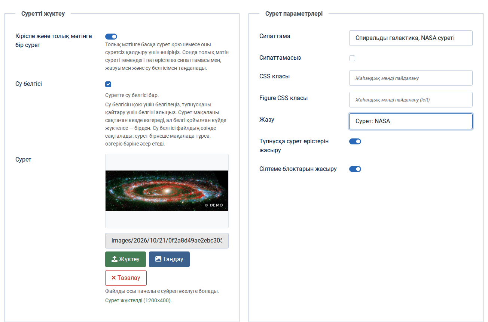
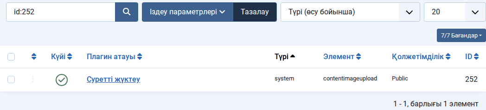
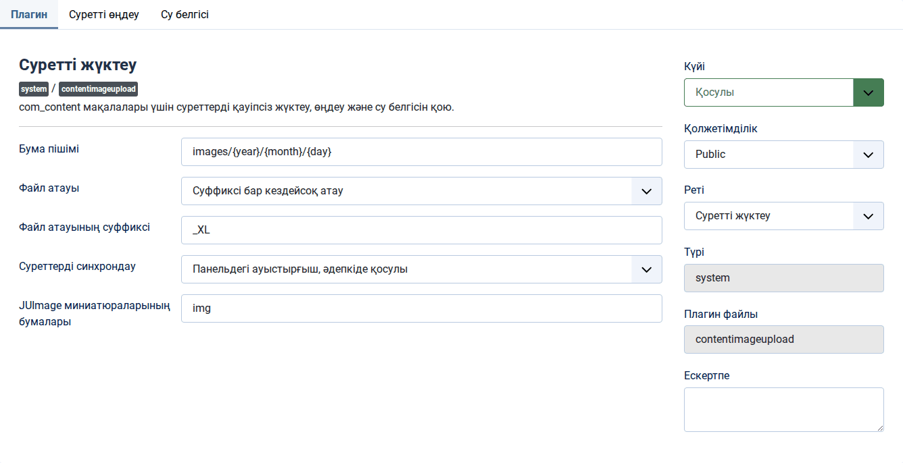
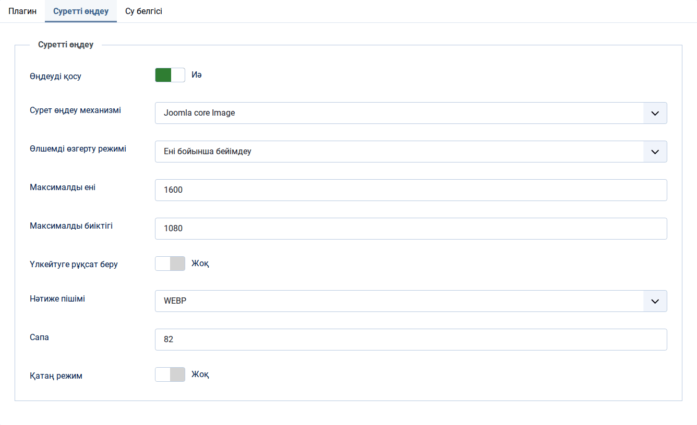
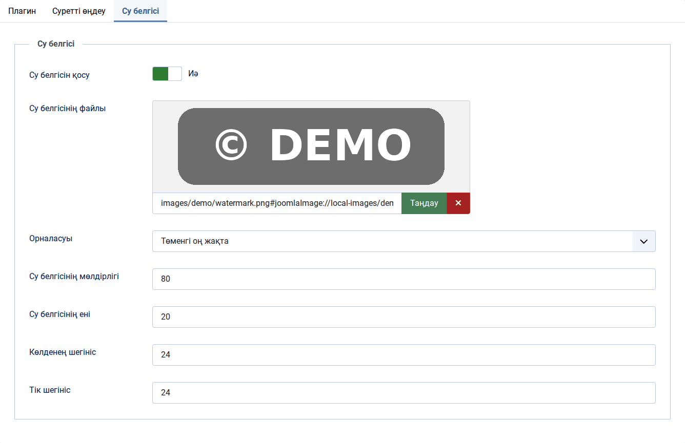
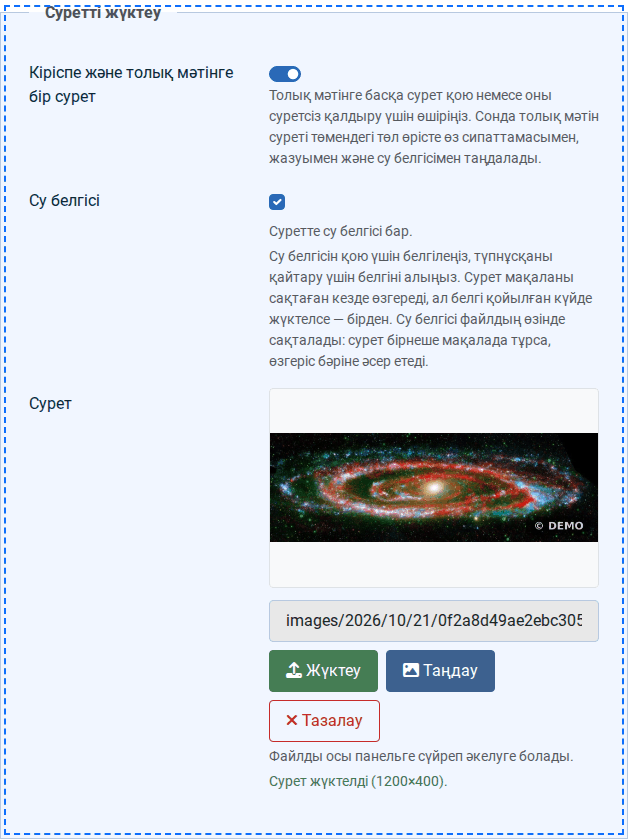
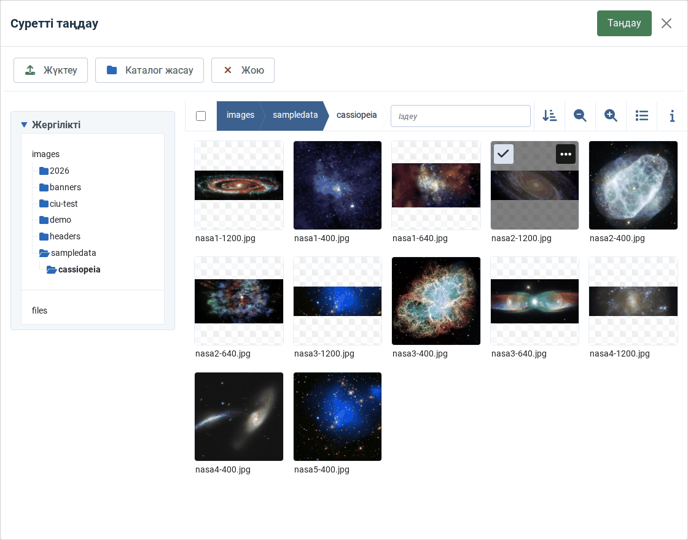
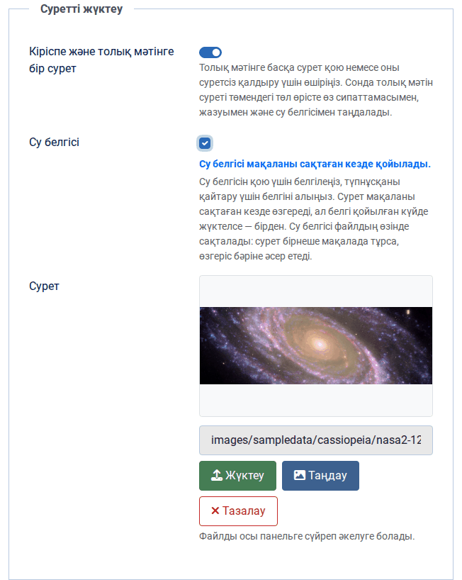
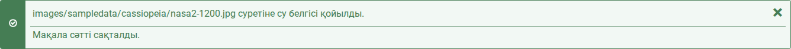
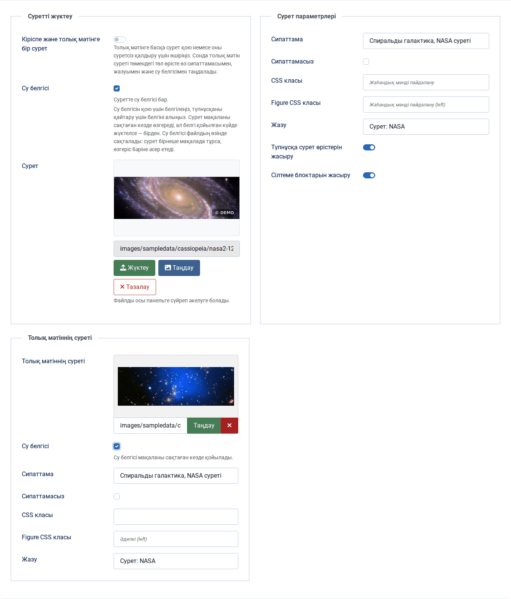

# Content Image Upload

[Русский](README.md) · **Қазақша** · [English](README.en.md)

Joomla 6 мақала редакторына арналған жүйелік плагин. Ол «Суреттер мен сілтемелер» қойындысына панель қосады: суретті батырмамен жүктеуге немесе панельге сүйреп әкелуге, медиа менеджерінен таңдауға, кішірейтуге, WebP не AVIF пішіміне айналдыруға және қажет болса кейін алып тастауға болатын су белгісін қоюға болады. Бір сурет бірден кіріспе мәтіннің де, толық мәтіннің де суреті болады, ал толық мәтінге басқа сурет керек болса, синхрондау бір ауыстырғышпен өшіріледі.



Нұсқа 2.0.0 · Joomla 6.0 және одан жоғары · GD кеңейтімі бар PHP 8.3 және одан жоғары · GNU GPL 2 немесе одан кейінгі лицензия

Жүктеп алу: [GitHub-тағы релиздер](https://github.com/bsakhanov/plg_system_contentimageupload/releases) · авторы — Бейбіт Саханов, [webmarka.kz](https://webmarka.kz)

## Мазмұны

- [Мүмкіндіктер](#мүмкіндіктер)
- [Талаптар](#талаптар)
- [Орнату және жаңарту](#орнату-және-жаңарту)
- [Баптау](#баптау)
- [Редакторда жұмыс істеу](#редакторда-жұмыс-істеу)
- [Плагин суретті қалай жүктейді](#плагин-суретті-қалай-жүктейді)
- [Сурет қою жолдары](#сурет-қою-жолдары)
- [Медиа менеджерінен айырмашылығы](#медиа-менеджерінен-айырмашылығы)
- [JUImage және wmarka шаблонымен үйлесімділік](#juimage-және-wmarka-шаблонымен-үйлесімділік)
- [Түпнұсқалар қайда сақталады](#түпнұсқалар-қайда-сақталады)
- [Тексерулер және қауіпсіздік](#тексерулер-және-қауіпсіздік)
- [Сұрақтар мен шешімдер](#сұрақтар-мен-шешімдер)
- [Құрылымы](#құрылымы)
- [Авторлығы және лицензиясы](#авторлығы-және-лицензиясы)

## Мүмкіндіктер

- Бір батырмамен немесе файлды панельге сүйреп әкеліп жүктеу, бет қайта жүктелмейді.
- Айнымалылары бар үлгі бойынша бума, мысалы `images/2026/10/21`; күн пайдаланушының уақыт белдеуі бойынша алынады.
- Қайталанбайтын файл атауы: кездейсоқ, күн бойынша немесе бастапқы атаудың транслитерациясы; орыс және қазақ кириллицасы латыншаға ауыстырылады.
- Жүктеу кезінде өңдеу: өлшемді өзгертудің бес режимі, WebP, AVIF, JPG және басқа пішімдерге айналдыру, сапа, телефоннан түсірілген суретті EXIF белгісі бойынша бұру.
- Кіріспе және толық мәтінге бір сурет немесе екі түрлі сурет — мұны редактор ауыстырғышпен шешеді.
- Алып тастауға болатын су белгісі: белгіні қоймас бұрын плагин түпнұсқаны сақтайды.
- Өріс мәні Joomla өзі жазатын түрде сақталады, сондықтан сайттағы `` тегінде `width`, `height` және `loading="lazy"` болады.
- Су белгісі өзгергеннен кейін JUImage миниатюралары жаңарады, сондықтан wmarka шаблоны жаңа суретті бірден көрсетеді.
- Интерфейс орыс, қазақ және ағылшын тілдерінде.

## Талаптар

- Joomla 6.0 және одан жоғары.
- GD кеңейтімі бар PHP 8.3 және одан жоғары. WebP пен AVIF үшін оларды қолдайтын GD жинағы, телефон суреттерін бұру үшін `exif` кеңейтімі керек.
- Пайдаланушы құқықтары: жүктеу үшін медиа менеджеріндегі «Жасау», су белгісі үшін «Жасау» немесе «Өңдеу», сондай-ақ мақаланың өзіне құқық.

## Орнату және жаңарту

1. «Жүйе → Орнату → Кеңейтімдер» бөлімін ашып, «Жүктеу және орнату» қойындысына `plg_system_contentimageupload-2.0.0.zip` мұрағатын сүйреп әкеліңіз. Консольде дәл осыны мына команда орындайды:

   ```
   php cli/joomla.php extension:install --path=plg_system_contentimageupload-2.0.0.zip
   ```

2. Алғаш орнатқаннан кейін плагин өшірулі тұрады. «Жүйе → Плагиндер» бөлімін ашып, «Суретті жүктеу» плагинін тауып, қосыңыз.

   

3. Плагинді ашып, баптаулардың үш қойындысын қарап шығыңыз («Баптау» бөлімін қараңыз). Су белгісі керек болса, оны қосып, белгі файлын таңдаңыз.

Файлдармен жұмыс істеу ыңғайлы болса, релизден `plg_system_contentimageupload-2.0.0-site-root.zip` мұрағатын алыңыз: ол тікелей сайт түбіріне ашылады, содан кейін «Жүйе → Орнату → Іздеу» плагинді тауып, тіркейді.

Жаңартулар Joomla арқылы келеді: плагин осы репозиторийдегі жаңарту серверіне қосылған, жаңа нұсқа кеңейтімдердің қолжетімді жаңартулары арасында пайда болады. Қолмен жаңарту бұрынғы нұсқаның үстіне дәл осылай орнатылады, баптаулар сақталады. 1.6 нұсқасы әкімші кэшінде ұстаған түпнұсқаларды плагин суретке алғаш жүгінгенде жаңа қоймаға өзі көшіреді.

Плагинді жойғанда түпнұсқалары бар `images/.contentimageupload` бумасы орнында қалады: бұл плагиннің файлдары емес, сайттың деректері.

## Баптау

### «Плагин» қойындысы: негізгі параметрлер



| Баптау | Әдепкі мәні | Не істейді |
|---|---|---|
| Бума пішімі | `images/{year}/{month}/{day}` | Жүктеулерге арналған бума үлгісі. Жол `images/` деп басталады, жоғары өтуге (`..`) тыйым салынған. Айнымалылар: `{user_id}` — пайдаланушы ID-і, `{year}`, `{month}`, `{day}`, `{week_year}` — жылдағы апта нөмірі, `{week_day}` — нөлден бастап апта күні, `{day_year}` — нөлден бастап жыл күні, `{hours}` — 12 сағаттық пішімдегі сағат, `{hours_24}`, `{minutes}`, `{seconds}`, `{unix}` — UNIX уақыты. Мысал: `images/{user_id}/{year}-{month}-{day}`. |
| Файл атауы | «Суффиксі бар кездейсоқ атау» | «Суффиксі бар кездейсоқ атау» `2e27f9637dce51e6669b3ef745d393d6_xl-5269a2bed740ef54.jpg` береді, «Күн + hash» — `20261021_143005_9f2c1e0a5b7d4c3e-5269a2bed740ef54.jpg`, «Түпнұсқа атауды транслитерациялау» «Фото репортаж.jpg» атауын `foto-reportazh-5269a2bed740ef54.jpg` етеді. Кез келген атауға 16 таңбалы кездейсоқ қосымша жалғанады, сондықтан бар файл ешқашан қайта жазылмайды. |
| Файл атауының суффиксі | `_XL` | Тек кездейсоқ атау үшін; кіші латын әріптерімен жазылады, `_XL` — `_xl` болады. |
| Суреттерді синхрондау | «Панельдегі ауыстырғыш, әдепкіде қосулы» | «Әрқашан, ауыстырғышсыз» екі өріске бір суретті ұстайды. Қалған екі режим панельге ауыстырғыш қояды, ал жаңа мақала үшін оның бастапқы күйін белгілейді. Толығырақ — «Бір сурет немесе екі сурет» бөлімінде. |
| JUImage миниатюраларының бумалары | `img` | Шаблон JUImage миниатюраларын сақтайтын бумалар, сайт түбірінен бастап, үтір арқылы; wmarka үшін — `img`. Су белгісін қойғаннан немесе алғаннан кейін плагин сол бумалардағы өзгерген суреттің миниатюраларын өшіреді. Бос өріс тазалауды өшіреді, `images` бумасы қабылданбайды. |

### «Суретті өңдеу» қойындысы

Суретте — мысал: суреттер ені бойынша 1600 пиксельге дейін кішірейтіліп, WebP пішіміне айналдырылады.



| Баптау | Әдепкі мәні | Не істейді |
|---|---|---|
| Өңдеуді қосу | иә | Қосулы тұрғанда файл жүктеу кезінде әрдайым қайта кодталады, өлшемі мен пішімі өзгермесе де: осылайша сурет EXIF бойынша бұрылады да, метадеректерінен (камера үлгісі, түсірілген күні, GPS координаттары) айырылады. Файлды байтпа-байт сақтау үшін өшіріңіз. |
| Сурет өңдеу механизмі | Joomla core Image | Жалғыз нұсқа: GD кеңейтіміне негізделген `Joomla\CMS\Image\Image` класы. |
| Өлшемді өзгерту режимі | «Өзгертпеу» | «Шекараға сыйдыру» суретті «максималды ені × максималды биіктігі» жақтауына толық сыйғызып, бос жиектерін түспен толтырады. «Нақты өлшемге қиып алу» жақтауды толтырып, артығын ортасынан қиып тастайды. «Ені бойынша бейімдеу» енін максималды мәнге теңестіріп, биіктігін пропорция бойынша есептейді; «Биіктігі бойынша бейімдеу» — керісінше. |
| Максималды ені, максималды биіктігі | 1920 және 1080 пиксель | Өлшем режимдерінің шекаралары; 0 сол жақтағы шектеуді алып тастайды. |
| Сурет толтыру түсі | `#ffffff` | «Шекараға сыйдыру» режиміндегі жиектердің түсі. |
| Үлкейтуге рұқсат беру | жоқ | Берілген өлшемнен кіші суреттерді үлкейтуге рұқсат береді; онсыз жақтау суреттің өзінен үлкен болмайды. |
| Нәтиже пішімі | «Бастапқыны сақтау» | JPG, PNG, GIF, WebP, AVIF немесе BMP. Қай пішімнің қолжетімді екенін сервердегі GD жинағы шешеді. JPG пішіміне айналдырғанда мөлдір жерлер ақ түспен толтырылады. |
| Сапа | 82 | JPG, WebP және AVIF үшін, 1-ден 100-ге дейін. Су белгісі қойылғаннан кейін сурет осы сапамен қайта кодталады. |
| PNG сығу | 6 | 0-ден 9-ға дейін; нәтиже пішімі PNG болғанда да, «Бастапқыны сақтау» тұрғанда да PNG файлдарына әсер етеді. |
| Қатаң режим | жоқ | Өшірулі болса, өңдеу сәтсіз аяқталғанда бастапқы файл сақталады. Қосулы болса, жүктеу қате туралы хабармен тоқтатылады. |

### «Су белгісі» қойындысы



| Баптау | Әдепкі мәні | Не істейді |
|---|---|---|
| Су белгісін қосу | жоқ | Редакторда «Су белгісі» құсбелгісін көрсетеді. Өшірулі тұрғанда плагин су белгісін қоймайды да, алмайды да. |
| Су белгісінің файлы | — | `images` бумасындағы сурет. Ең жақсысы — мөлдір фоны бар PNG. |
| Орналасуы | «Төменгі оң жақта» | Жоғары сол жақта, жоғары оң жақта, ортасында, төменгі сол жақта, төменгі оң жақта. |
| Су белгісінің мөлдірлігі | 80 | Шын мәнінде бұл мөлдір еместік: 100 — белгі тұтас, азырақ болса — мөлдірірек. PNG файлының өз мөлдірлігі осы мәнге көбейтіледі, логотиптің жұмсақ жиектері жұмсақ күйінде қалады. |
| Су белгісінің ені | 20 % | Сурет енінің үлесі; биіктігі белгінің пропорциясы бойынша есептеледі. Белгі шегіністерімен бірге сыймаса, кішірейтіледі. |
| Көлденең және тік шегініс | 24 пиксель | Сурет жиектерінен қашықтық; «Ортасында» орналасуында қолданылмайды. |

### Медиа менеджерінің баптауларынан не алынады

«Медиа менеджері → Баптаулар» бөлімінен плагин рұқсат етілген сурет кеңейтімдерін, жүктеуге шектеу қосулы болса — рұқсат етілген кеңейтімдер тізімін және файлдың ең үлкен өлшемін (әдепкіде 10 МБ) оқиды. MIME тексеруі мен тыйым салынған түрлер медиа менеджерінің өзіндегідей `MediaHelper::canUpload` арқылы жұмыс істейді. Олармен қатар PHP-дің `upload_max_filesize` және `post_max_size` шектеулері әрекет етеді.

## Редакторда жұмыс істеу

Мақаланы ашыңыз (немесе «Мақалалар → Жасау» арқылы жаңасын жасаңыз) да, «Суреттер мен сілтемелер» қойындысына өтіңіз. Жоғарыда плагин панелі тұрады.

Сол жақта, «Суретті жүктеу» блогында:

- «Кіріспе және толық мәтінге бір сурет» ауыстырғышы;
- суреттің қазіргі күйі туралы кеңесі бар «Су белгісі» құсбелгісі;
- суреттің алдын ала көрінісі, файлға апаратын жол және «Жүктеу», «Таңдау», «Тазалау» батырмалары;
- жүктеу күйін көрсететін жол.

Оң жақта, «Сурет параметрлері» блогында — сипаттама (alt), «Сипаттамасыз», CSS класы, figure класы және жазу. Мұнда жазылғанды плагин Joomla өрістеріне көшіреді. Төмендегі екі ауыстырғыш төл сурет өрістерін және A, B, C сілтеме блоктарын жасырады; мақала әр ашылған сайын олар қайтадан қосулы тұрады.

### Жаңа суретті жүктеу

1. Суретке су белгісі керек болса, «Су белгісі» құсбелгісін алдын ала қойыңыз: сонда белгі жүктеу кезінде бірден қойылады.
2. «Жүктеу» батырмасын басып, файлды таңдаңыз. Файлды тышқанмен панельдің сол жақ жартысына сүйреп әкелуге де болады — ол пунктирмен ерекшеленеді.

   

3. Суреттің өлшемі көрсетілген «Сурет жүктелді» жолын күтіңіз. Жол мен алдын ала көрініс жаңарады, ал файл серверде жатыр.
4. Оң жақтағы сипаттама мен жазуды толтырыңыз.
5. Мақаланы сақтаңыз.

Панельден тыс тасталған файлды бет елемейді: ол браузер қойындысында ашылмайды және сақталмаған мақаласы бар беттен алып кетпейді. Пішімі сәйкес келмейтін файл таңдалса, панель бұл туралы бірден айтады, серверге ештеңе жіберілмейді.

### Медиа менеджерінен суретті таңдау

«Таңдау» батырмасы Joomla медиа менеджерінің кәдімгі терезесін ашады. Суретті тауып, белгілеңіз де, терезенің жоғарғы жағындағы «Таңдау» батырмасын басыңыз.



Сурет екі өріске де қойылады (синхрондау өшірулі болса — тек кіріспе мәтіннің өрісіне). Плагин серверден суретте оның су белгісі бар-жоғын бірден сұрап, мұны құсбелгімен көрсетеді. Таңдау кезінде файлдың өзі өзгермейді: панель арқылы жүктелген суреттер ғана өңделеді.

Бұл терезенің ішіндегі «Жүктеу» батырмасы — медиа менеджерінің өз жүктеуі. Ол плагинді айналып өтеді: файл өз атауын сақтайды, ашық бумаға түседі және өңделмейді. Мұндай суретке су белгісін сақтау кезінде құсбелгімен қоюға болады.

### Су белгісін қою немесе алу

Құсбелгі файлда шын мәнінде не жатқанын көрсетеді, ал астындағы кеңес сақтағанда не болатынын айтады:

| Кеңес | Мағынасы |
|---|---|
| «Суретте су белгісі бар.» | Су белгісі әлдеқашан қойылған. |
| «Су белгісі жоқ.» | Сурет таза. |
| «Су белгісі мақаланы сақтаған кезде қойылады.» | Құсбелгі қойылды, су белгісі сақтағаннан кейін пайда болады. |
| «Су белгісі мақаланы сақтаған кезде алынады: түпнұсқа қайтарылады.» | Құсбелгі алынды, сақтағаннан кейін бастапқы файл қайтарылады. |
| «Су белгісі жүктеу кезінде қойылады.» | Сурет әлі жоқ, су белгісі жүктелетін суретке қойылады. |
| «Су белгісі тексерілуде…» | Плагин жаңа суреттің күйін серверден сұрап жатыр; жауап келгенше құсбелгі сұр түсті. |



Сақтағаннан кейін Joomla плагиннің не істегенін көрсетеді:



Сол жақта — қоймадағы түпнұсқа, оң жақта — құсбелгімен сақталғаннан кейінгі сол сурет:


Өзгеріссіз қайта сақтау файлға тиіспейді. Су белгісін қою мүмкін болмаса (белгі файлы жоқ, жады жетпейді), мақала бәрібір сақталады, ал Joomla себебі көрсетілген ескерту береді.

### Бір сурет немесе екі сурет

Joomla мақаласында екі сурет болады: кіріспе мәтіннің суреті тізімдер мен блогтарда, толық мәтіннің суреті мақаланың өз бетінде көрсетіледі. «Кіріспе және толық мәтінге бір сурет» ауыстырғышы қосулы тұрғанда панель оларды бір сурет етіп ұстайды: жүктеу, таңдау және тазалау екі өріске де жазылады, сипаттама, кластар және жазу да ортақ. Бір төл өрістегі суретті ауыстырсаңыз, екіншісі соның артынан ереді.

Мақала ашылғанда ауыстырғыш деректерге қарайды: екі өрісте бір сурет тұрса, ол қосулы, суреттер әртүрлі болса немесе бір өріс бос болса — өшірулі. Сондықтан суреттері әртүрлі ескі мақалаларға плагин тиіспейді.

Толық мәтінге басқа сурет беру немесе оны суретсіз қалдыру үшін ауыстырғышты өшіріңіз. Сонда панель тек кіріспе мәтіннің суретімен жұмыс істейді, ал «Толық мәтіннің суреті» төл өрісі төменде пайда болады, тіпті төл өрістер жасырылған болса да. Суретті сол жерде таңдайды, сипаттамасы мен жазуы да сонда. Толық мәтіннің суреті кіріспедегіден өзгеше болса, өрістің астында өз «Су белгісі» құсбелгісі пайда болады.



Ауыстырғышты қайта қоссаңыз, толық мәтіннің суреті сипаттамасымен, кластарымен және жазуымен бірге кіріспе мәтін суретінің көшірмесіне айналады.

### Тазалау

«Тазалау» панель өрістерін босатады. Файл дискіде және медиа менеджерінде қалады, оны қайта таңдауға болады.

## Плагин суретті қалай жүктейді

1. Файл форма токенімен бірге `com_ajax` мекенжайына фондық сұраныспен жіберіледі; бет қайта жүктелмейді, мақала әзірге сақталмайды.
2. Сервер құқықтар мен файлды тексереді («Тексерулер және қауіпсіздік» бөлімін қараңыз).
3. Плагин үлгі бойынша буманы құрады, қажет болса, оны жасайды.
4. Атау таңдалған режим бойынша құралып, 16 таңбалы кездейсоқ қосымша алады.
5. Өңдеу қосулы болса, сурет EXIF бойынша бұрылып, өлшемі, пішімі және сапасы өзгеріп, қайта жазылады. Өңдеу сәтсіз болса, қатаң режимсіз бастапқы файл сақталады, қатаң режимде жүктеу тоқтатылады.
6. «Су белгісі» құсбелгісі қойылған болса, белгі бірден қойылады, ал түпнұсқа қоймаға жіберіледі.
7. Өрістер мәнді Joomla өзі жазатын түрде алады: жол және `#joomlaImage://local-images/…?width=…&height=…`. Осы өлшемдер бойынша Joomla сайттағы `` тегіне `width`, `height` және `loading="lazy"` атрибуттарын шығарады, сондықтан бет жүктелгенде құрылымы секірмейді.

Файл жүктелген сәттен бастап дискіде жатады. Мақаланы сақтамай жапсаңыз, файл қалады — медиа менеджері арқылы жүктегендегідей.

## Сурет қою жолдары

| Редактор не істейді | Не болады |
|---|---|
| Файлды «Жүктеу» батырмасымен немесе сүйреп әкеліп жүктейді | Плагиннің толық жолы: тексерулер, үлгі бойынша бума, жаңа атау, өңдеу, құсбелгі қойылған болса — су белгісі. |
| Суретті «Таңдау» батырмасымен таңдайды | Мәнді Joomla медиа менеджері жазады, плагин оны екінші өріске көшіріп, су белгісінің күйін көрсетеді. Файл өзгермейді. |
| «Таңдау» терезесінің ішінде файл жүктейді | Медиа менеджері жұмыс істейді: өз атауы, ағымдағы бума, өңдеусіз. Су белгісін сақтау кезінде қоюға болады. |
| Төл өрістегі суретті ауыстырады | Синхрондау қосулы болса, екінші өріс өзгерген өрістің артынан ереді; өшірулі болса, өрістер тәуелсіз. |
| Жолды немесе сілтемені қолмен жазады | Joomla мекенжайды тексеріп, өлшемдерді қосады, плагин мәнді көшіріп, су белгісінің күйін анықтайды. Сыртқы сілтемеге су белгісін қою мүмкін емес, құсбелгі сұр түске енеді. |
| Редактордың «Сурет» батырмасымен суретті мәтінге қояды | Плагин қатыспайды: өңдеу де, су белгісі де жоқ. |
| Мақаланы сақтайды | Joomla мақаланы жазады, содан кейін плагин әр суреттің су белгісін оның құсбелгісінің күйіне келтіреді. |

## Медиа менеджерінен айырмашылығы

| | Joomla медиа менеджері | Content Image Upload |
|---|---|---|
| Қайда жүктеледі | «Медиа менеджері» бөлімі немесе «Сурет» өрісінің терезесі | батырма немесе сүйреп әкелу арқылы тікелей мақалада |
| Бума | қолмен таңдалады, әдепкіде `images` түбірі | үлгі бойынша өзі жасалады |
| Файл атауы | бастапқы атау, транслитерациясымен (серверде intl болса) және артық таңбалардан тазартылған | кездейсоқ, күн бойынша немесе транслитерация, әрдайым қайталанбайтын қосымшамен |
| Мұндай атаулы файл бар болса | ауыстыру керек пе деп сұрайды | болмайды: атау әр жолы жаңа |
| Мақала өрістері | кіріспе және толық мәтін суреттері бөлек таңдалады | бір жүктеу екі өрісті де толтырады; ауыстырғыш оларды екі суретке бөледі |
| Бір мезетте неше файл | бірнеше, сүйреп әкелуге болады | біреу |
| Жүктеу кезінде өңдеу | «Media Action - Resize» плагинінде берілсе ғана, үлкен суреттерді кішірейту | өлшемнің бес режимі, WebP, AVIF және басқа пішімдер, сапа, EXIF бойынша бұру |
| Қолмен түзету | медиа менеджері редакторында қию, өлшем, бұру | жоқ; файл медиа менеджерінде кәдімгі файл ретінде ашылады |
| Сурет метадеректері | сақталады, GPS-ті қоса | өңдеу қосулы болса, жойылады |
| Су белгісі | жоқ | бар, алып тастауға болады |
| Тексерулер | өлшем, MIME, атаудағы орындалатын кеңейтімдер | соларға қоса: файл ішіндегі PHP коды, нақты түрі бойынша кеңейтім, 25 млн пиксель шегі, мақалаға құқық |
| Қайда жұмыс істейді | медиа өрісі бар барлық жерде | тек әкімші бөлімінде, `com_content` мақала редакторында |

## JUImage және wmarka шаблонымен үйлесімділік

Плагин тек әкімші бөлімінде жұмыс істейді, ал сайтты шаблон шығарады, сондықтан олардың ортақ оқиғалары мен коды жоқ. Өріс мәнін плагин Joomla өзі жазатындай жазады, ал wmarka шаблоны JUImage-ді шақырмас бұрын `#joomlaImage://…` қосымшасын кесіп, таза жолды алады — мәннің екі түрін де бірдей оқиды.

JUImage-дің өзінде бір ерекшелік бар: миниатюраға бастапқы файлдың атауы мен параметрлердің хэші бойынша ат қояды, ал дайын миниатюраны бастапқы файлдың өзгергенін тексермей береді. Плагин болса су белгісін сол файлда, сол атаумен қояды және алады. Шаблон ескі суретті көрсетпеуі үшін су белгісі әр өзгерген сайын плагин «JUImage миниатюраларының бумалары» баптауында көрсетілген бумалардағы (wmarka үшін — `img`) сол суреттің миниатюраларын өшіреді, ал шаблон оларды бетті келесі ашқанда қайта жасайды. Су белгісі жүктеу кезінде бірден қойылса, миниатюралар әлі жоқ, сондықтан мәселе туындамайды.

Браузер кэші мен CDN-ге плагин тиіспейді: олар ескі көшірмені ұстап тұрғанда келуші суретті су белгісінсіз немесе су белгісімен көруі мүмкін.

## Түпнұсқалар қайда сақталады

Су белгісін алғаш қоймас бұрын плагин түпнұсқаны `images/.contentimageupload/` бумасына салады. Көшірменің атауы — сайт құпиясымен (`configuration.php` ішіндегі `secret`) есептелген сурет жолының HMAC мәні, сондықтан суреттің жария мекенжайы бойынша таза түпнұсқаның мекенжайын есептеп шығару мүмкін емес. Атауы нүктеден басталатын бумаларды медиа менеджері көрсетпейді, кэшті тазалау оған тиіспейді, ал `.htaccess` пен `web.config` оны Apache мен IIS-те тікелей қол жеткізуден жабады.

Есте сақтау керегі:

- Су белгісі мақалада емес, файлдың өзінде тұрады. Бір сурет бірнеше мақалада тұрса, кез келгеніндегі құсбелгі оны барлығы үшін өзгертеді.
- `images/.contentimageupload` бумасын жоюға болмайды: онсыз су белгісін алу мүмкін болмайды.
- `configuration.php` ішіндегі `secret` ауыстырылса, плагин ескі түпнұсқаларды таба алмайды.

## Тексерулер және қауіпсіздік

Жүктеу тек әкімші бөлімінде, тек форма токені бар POST сұранысымен және тек медиа менеджерінде «Жасау» құқығы бар, жүйеге кірген пайдаланушыдан қабылданады. Бар мақала үшін оны өңдеу құқығы, жаңасы үшін таңдалған санатта мақала жасау құқығы керек.

Файл мына тексерулерден өтеді: PHP жүктеу қателері, нөлдік емес өлшем және медиа менеджерінің шегі, атаудың кез келген бөлігіндегі орындалатын кеңейтімдер (`photo.php.jpg` қабылданбайды), мазмұндағы `<?php` жолы, `MediaHelper::canUpload` ережелері, рұқсат етілген кеңейтім. Түрі файлдың мазмұны бойынша анықталады: `.jpg` кеңейтімі бар PNG `.png` болып сақталады. 25 млн пиксельден үлкен суреттер қабылданбайды, ал өңдеу алдында плагин PHP жадының шегін тексеріп, ақ экранның орнына түсінікті қате береді.

## Сұрақтар мен шешімдер

**«Суреттер мен сілтемелер» қойындысында панель жоқ.** Плагиннің қосулы екенін тексеріңіз. Панель әкімші бөліміндегі мақаланың стандартты формасында жұмыс істейді; әкімші шаблоны бұл форманы қайта анықтаса, қойынды `images` идентификаторын және төл сурет өрістерін сақтауы керек.

**«Су белгісі» құсбелгісі жоқ.** Плагин баптауларының «Су белгісі» қойындысында су белгісін қосыңыз.

**Құсбелгі сұр түсті.** Плагин суреттің күйін анықтай алмады: файл дискіде жоқ, сурет `images` бумасынан тыс жатыр немесе бұл сыртқы сілтеме. Сақтау кезінде мұндай сурет өзгермейді.

**Сақтағаннан кейін сайтта су белгісі көрінбеді.** Бетті браузер кэшінсіз жаңартыңыз. Сайт CDN арқылы жұмыс істесе, оның кэшін тазалаңыз. Шаблон JUImage пайдаланса, оның миниатюралар бумасы «JUImage миниатюраларының бумалары» баптауында көрсетілгенін тексеріңіз.

**«PHP жадысы жетпейді».** Сурет сервердегі `memory_limit` үшін тым үлкен: жүктемес бұрын оны кішірейтіңіз немесе шекті көтеріңіз.

**«Таңдау» батырмасы медиа менеджерін таппағанын айтады.** Сайтта медиа өрісі бөгде менеджермен ауыстырылған (мысалы, Quantum Manager немесе JCE). Бұл жағдайда жүктеу мен сүйреп әкелу жұмыс істейді, ал суретті төл өрісте таңдауға болады.

**Қателердің толық мәліметі.** Плагин оларды `administrator/logs/plg_system_contentimageupload.php` журналына жазады.

## Құрылымы

| Файл | Ішінде не бар |
|---|---|
| `services/provider.php` | Joomla 6 ядросының плагиндеріндегідей плагинді тіркеу |
| `src/Extension/ContentImageUpload.php` | `onBeforeCompileHead`, `onContentPrepareData`, `onContentAfterSave` оқиғалары және `onAjaxContentimageupload` AJAX өңдеушісі (`ciuAction=upload` және `ciuAction=status`) |
| `src/Service/JoomlaCoreImageProcessor.php` | жүктеу кезінде өлшем мен пішімді өзгерту |
| `src/Service/WatermarkService.php` | су белгісін қою |
| `src/Service/OriginalStore.php` | түпнұсқаларды сақтау және қайтару |
| `src/Service/ImageTools.php` | GD арқылы оқу және жазу, EXIF бойынша бұру, жадты тексеру |
| `media/js/admin.js` | редактордағы панель, сүйреп әкелу, өрістерді синхрондау |
| `script.php` | PHP мен Joomla нұсқаларын тексеру, ескі баптауларды көшіру |

Мақала формасымен бірге `ciu_watermark` (жасырын «0» және «1» құсбелгісі), бөлек толық мәтін суреті үшін дәл сондай `ciu_watermark_full` және синхрондау күйін беретін `ciu_sync` өрістері жіберіледі. Сұраныста құсбелгі өрісі болмаса, сервер файлға тиіспейді.

Нұсқалар тарихы — [CHANGELOG.kk.md](CHANGELOG.kk.md) файлында.

## Авторлығы және лицензиясы

Авторы және сүйемелдеушісі — Бейбіт Саханов, [webmarka.kz](https://webmarka.kz). Плагин Content Image Upload 1.6 (© 2026 Хабар) негізінде өсті, ал жүктеу кезінде суретті өңдеу WT Image Resize and Convert (WebTolk) плагинінің тәсілдеріне сүйенеді. Екі жұмыс та GNU GPL бойынша шығарылған, бұл нұсқа да сол шарттармен таратылады: GNU General Public License 2-нұсқасы немесе одан кейінгісі, толық мәтіні — [LICENSE](LICENSE) файлында.
