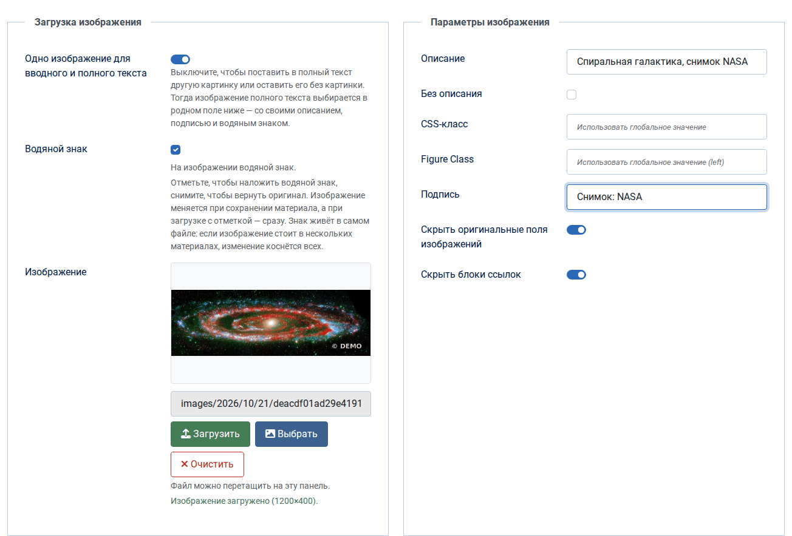
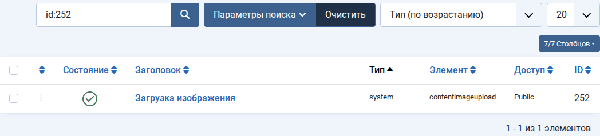
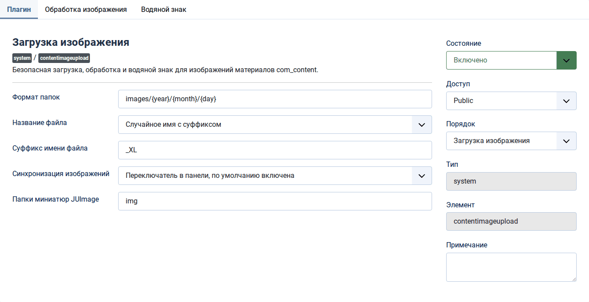
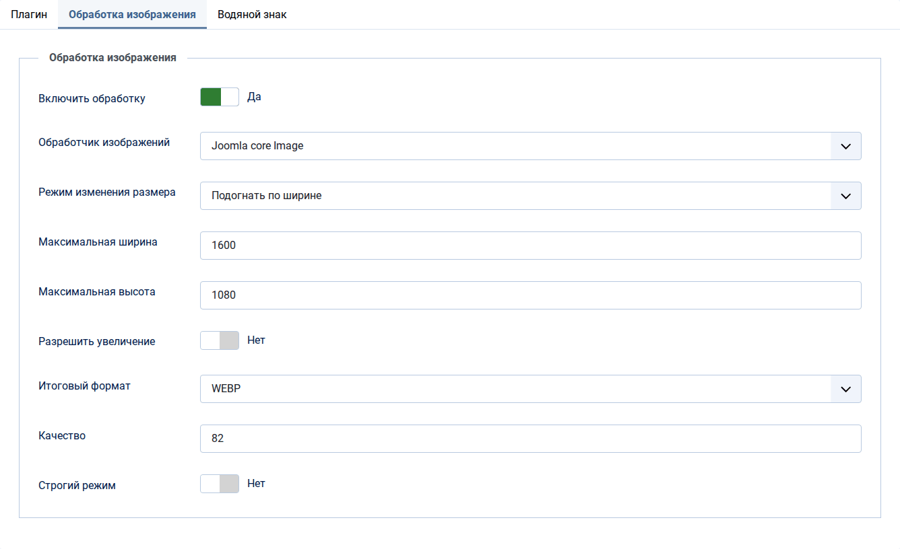
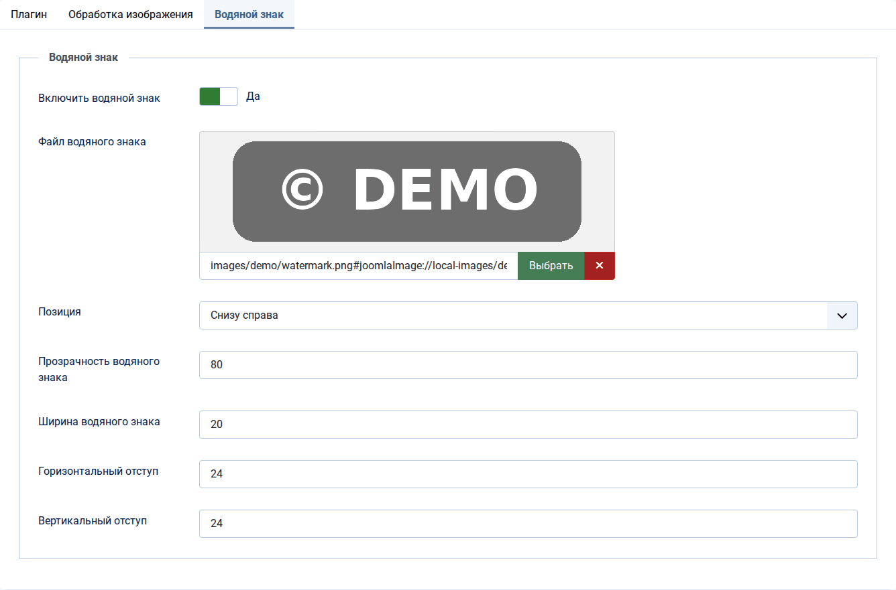
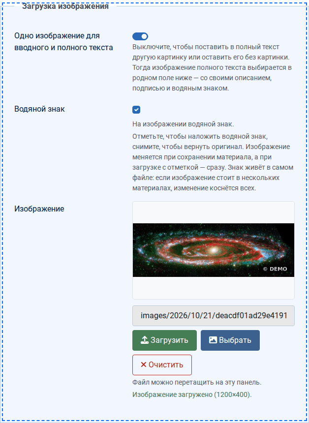
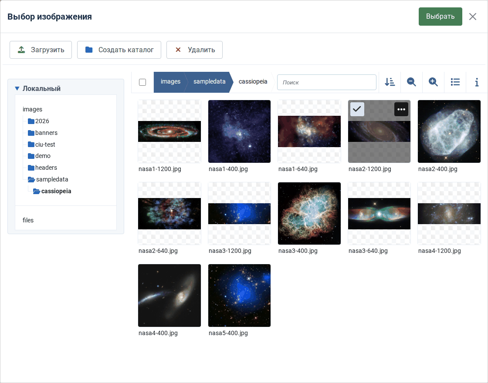
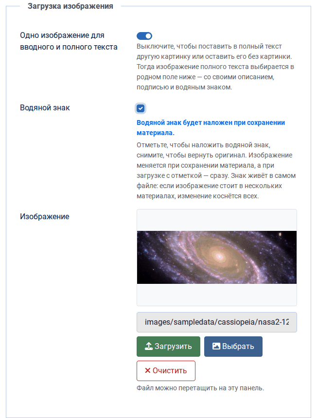
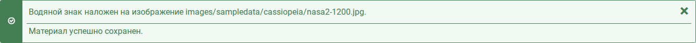
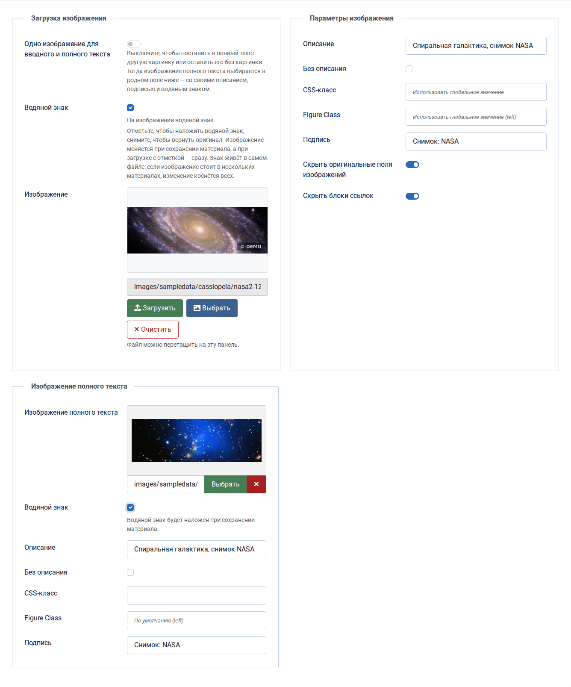

# Content Image Upload

**Русский** · [Қазақша](README.kk.md) · [English](README.en.md)

Системный плагин Joomla 6 для редактора материалов. На вкладку «Изображения и ссылки» он ставит панель, через которую картинку загружают кнопкой или перетаскиванием, выбирают из медиа-менеджера, уменьшают, переводят в WebP или AVIF и при желании закрывают водяным знаком, который потом можно снять. Одна картинка сразу становится изображением вводного и полного текста, а если полному тексту нужна своя, синхронизацию выключают одним переключателем.



Версия 2.0.0 · Joomla 6.0 и выше · PHP 8.3 и выше с расширением GD · лицензия GNU GPL 2 или новее

Скачать: [релизы на GitHub](https://github.com/bsakhanov/plg_system_contentimageupload/releases) · автор — Бейбит Саханов, [webmarka.kz](https://webmarka.kz)

## Содержание

- [Возможности](#возможности)
- [Требования](#требования)
- [Установка и обновление](#установка-и-обновление)
- [Настройка](#настройка)
- [Работа в редакторе](#работа-в-редакторе)
- [Как плагин загружает изображение](#как-плагин-загружает-изображение)
- [Сценарии вставки](#сценарии-вставки)
- [Чем отличается от медиа-менеджера](#чем-отличается-от-медиа-менеджера)
- [Совместимость с JUImage и шаблоном wmarka](#совместимость-с-juimage-и-шаблоном-wmarka)
- [Где хранятся оригиналы](#где-хранятся-оригиналы)
- [Проверки и безопасность](#проверки-и-безопасность)
- [Вопросы и решения](#вопросы-и-решения)
- [Устройство](#устройство)
- [Авторство и лицензия](#авторство-и-лицензия)

## Возможности

- Загрузка в один клик или перетаскиванием файла на панель, без перезагрузки страницы.
- Папка по шаблону с переменными, например `images/2026/10/21`; дата берётся в часовом поясе пользователя.
- Уникальное имя файла: случайное, по дате или транслит исходного, русская и казахская кириллица переводится в латиницу.
- Обработка при загрузке: пять режимов размера, перевод в WebP, AVIF, JPG и другие форматы, качество, поворот снимков с телефона по метке EXIF.
- Одна картинка на вводный и полный текст или две разные — решает редактор переключателем.
- Водяной знак, который снимается: перед наложением плагин сохраняет оригинал.
- Значение поля в том же виде, что пишет сама Joomla, поэтому на сайте у `` есть `width`, `height` и `loading="lazy"`.
- Миниатюры JUImage обновляются после смены знака, так что шаблон wmarka сразу показывает новую картинку.
- Интерфейс на русском, казахском и английском языках.

## Требования

- Joomla 6.0 и выше.
- PHP 8.3 и выше с расширением GD. Для WebP и AVIF нужна сборка GD с их поддержкой, для поворота снимков с телефона — расширение `exif`.
- Права пользователя: «Создать» в медиа-менеджере для загрузки, «Создать» или «Редактировать» — для водяного знака, плюс права на сам материал.

## Установка и обновление

1. Откройте «Система → Установка → Расширения», вкладку «Загрузить и установить», и перетащите туда архив `plg_system_contentimageupload-2.0.0.zip`. Из консоли то же самое делает команда

   ```
   php cli/joomla.php extension:install --path=plg_system_contentimageupload-2.0.0.zip
   ```

2. После первой установки плагин выключен. Откройте «Система → Плагины», найдите «Загрузка изображения» и включите его.

   

3. Откройте плагин и пройдите три вкладки настроек (см. «Настройка»). Если нужен водяной знак, включите его и выберите файл знака.

Если удобнее работать с файлами, возьмите из релиза архив `plg_system_contentimageupload-2.0.0-site-root.zip`: он распаковывается прямо в корень сайта, после чего «Система → Установка → Поиск» находит плагин и регистрирует его.

Обновления приходят через Joomla: плагин подключён к серверу обновлений в этом репозитории, и новая версия появляется среди доступных обновлений расширений. Вручную обновление ставится поверх прежней версии тем же способом, настройки сохраняются. Оригиналы, которые версия 1.6 держала в кэше администратора, плагин сам перенесёт в новое хранилище при первом обращении к картинке.

При удалении плагина папка `images/.contentimageupload` с оригиналами остаётся на месте: это данные сайта, а не файлы плагина.

## Настройка

### Вкладка «Плагин»: основные настройки



| Настройка | По умолчанию | Что делает |
|---|---|---|
| Формат папок | `images/{year}/{month}/{day}` | Шаблон папки для загрузок. Путь начинается с `images/`, переход наверх (`..`) запрещён. Переменные: `{user_id}` — ID пользователя, `{year}`, `{month}`, `{day}`, `{week_year}` — номер недели в году, `{week_day}` — день недели с нуля, `{day_year}` — день года с нуля, `{hours}` — часы в 12-часовом формате, `{hours_24}`, `{minutes}`, `{seconds}`, `{unix}` — время UNIX. Пример: `images/{user_id}/{year}-{month}-{day}`. |
| Название файла | «Случайное имя с суффиксом» | «Случайное имя с суффиксом» даёт `2e27f9637dce51e6669b3ef745d393d6_xl-5269a2bed740ef54.jpg`, «Дата + hash» — `20261021_143005_9f2c1e0a5b7d4c3e-5269a2bed740ef54.jpg`, «Транслит оригинального имени» превращает «Фото репортаж.jpg» в `foto-reportazh-5269a2bed740ef54.jpg`. К любому имени дописывается случайный хвост из 16 знаков, поэтому существующий файл никогда не перезаписывается. |
| Суффикс имени файла | `_XL` | Только для случайного имени; пишется строчными латинскими буквами, `_XL` превращается в `_xl`. |
| Синхронизация изображений | «Переключатель в панели, по умолчанию включена» | «Всегда, без переключателя» держит одну картинку на оба поля. Два других режима ставят в панель переключатель, а для нового материала задают его начальное положение. Подробности — в разделе «Одно или два изображения». |
| Папки миниатюр JUImage | `img` | Папки от корня сайта через запятую, где шаблон хранит миниатюры JUImage; у wmarka это `img`. После наложения или снятия знака плагин удаляет там миниатюры изменённой картинки. Пустое поле выключает очистку, папка `images` не принимается. |

### Вкладка «Обработка изображения»

На снимке — пример: картинки уменьшаются до 1600 пикселей по ширине и переводятся в WebP.



| Настройка | По умолчанию | Что делает |
|---|---|---|
| Включить обработку | да | Пока включена, файл при загрузке перекодируется всегда, даже без смены размера и формата: так снимок поворачивается по EXIF и теряет метаданные (модель камеры, дату, координаты GPS). Выключите, чтобы сохранять файл байт в байт. |
| Обработчик изображений | Joomla core Image | Единственный вариант: класс `Joomla\CMS\Image\Image` на расширении GD. |
| Режим изменения размера | «Не изменять» | «Вписать в границу» помещает картинку целиком в рамку «максимальная ширина × максимальная высота» и заливает пустые поля цветом. «Обрезать до точного размера» заполняет рамку и срезает лишнее по центру. «Подогнать по ширине» ставит ширину равной максимальной и считает высоту по пропорциям; «Подогнать по высоте» — наоборот. |
| Максимальная ширина, максимальная высота | 1920 и 1080 пикселей | Границы для режимов размера; 0 снимает ограничение по этой стороне. |
| Цвет заливки изображения | `#ffffff` | Цвет полей в режиме «Вписать в границу». |
| Разрешить увеличение | нет | Разрешает растягивать картинки меньше заданного размера; без этого рамка не бывает больше самой картинки. |
| Итоговый формат | «Оставить исходный» | JPG, PNG, GIF, WebP, AVIF или BMP. Доступность форматов решает сборка GD на сервере. Прозрачность при переводе в JPG заливается белым. |
| Качество | 82 | Для JPG, WebP и AVIF, от 1 до 100. Тем же качеством картинка перекодируется после наложения знака. |
| Сжатие PNG | 6 | От 0 до 9; действует на PNG и при итоговом формате PNG, и при «Оставить исходный». |
| Строгий режим | нет | Выключен — при сбое обработки сохраняется исходный файл. Включён — загрузка отменяется с сообщением об ошибке. |

### Вкладка «Водяной знак»



| Настройка | По умолчанию | Что делает |
|---|---|---|
| Включить водяной знак | нет | Показывает в редакторе галочку «Водяной знак». Пока выключено, плагин знак не ставит и не снимает. |
| Файл водяного знака | — | Картинка из папки `images`. Лучше всего PNG с прозрачным фоном. |
| Позиция | «Снизу справа» | Сверху слева, сверху справа, по центру, снизу слева, снизу справа. |
| Прозрачность водяного знака | 80 | По сути это непрозрачность: 100 — знак плотный, меньше — прозрачнее. Собственная прозрачность PNG умножается на это значение, мягкие края логотипа остаются мягкими. |
| Ширина водяного знака | 20 % | Доля ширины картинки; высота считается по пропорциям знака. Если знак с отступами не помещается, он ужимается. |
| Горизонтальный и вертикальный отступ | 24 пикселя | Расстояние от краёв картинки; для позиции «По центру» не используется. |

### Что берётся из настроек медиа-менеджера

Из «Медиа-менеджер → Настройки» плагин читает допустимые расширения изображений, при включённом ограничении загрузки — ещё и список разрешённых расширений, а также максимальный размер файла (по умолчанию 10 МБ). Проверка MIME и запрещённые типы работают через `MediaHelper::canUpload`, как в самом медиа-менеджере. Сверху действуют лимиты PHP `upload_max_filesize` и `post_max_size`.

## Работа в редакторе

Откройте материал (или создайте новый в «Материалы → Создать») и перейдите на вкладку «Изображения и ссылки». Вверху стоит панель плагина.

Слева, в блоке «Загрузка изображения»:

- переключатель «Одно изображение для вводного и полного текста»;
- галочка «Водяной знак» с подсказкой о текущем состоянии картинки;
- превью, путь к файлу и кнопки «Загрузить», «Выбрать», «Очистить»;
- строка состояния загрузки.

Справа, в блоке «Параметры изображения», — описание (alt), «Без описания», CSS-класс, класс figure и подпись. Что вписали здесь, плагин переносит в поля Joomla. Два переключателя внизу прячут родные поля изображений и блоки ссылок A, B, C; при каждом открытии материала они снова включены.

### Загрузить новую картинку

1. Если картинке нужен знак, отметьте «Водяной знак» заранее: тогда он встанет сразу при загрузке.
2. Нажмите «Загрузить» и выберите файл. Можно и просто перетащить файл мышью на левую половину панели — она подсветится пунктиром.

   

3. Дождитесь строки «Изображение загружено» с размерами картинки. Путь и превью обновятся, а файл уже лежит на сервере.
4. Заполните описание и подпись справа.
5. Сохраните материал.

Файл, брошенный мимо панели, страница игнорирует: он не откроется во вкладке браузера и не уведёт со страницы с несохранённым материалом. Если выбран файл не того формата, панель сразу скажет об этом, на сервер ничего не уйдёт.

### Выбрать картинку из медиа-менеджера

Кнопка «Выбрать» открывает обычное окно медиа-менеджера Joomla. Найдите картинку, отметьте её и нажмите «Выбрать» в шапке окна.



Картинка встанет в оба поля (или только во вводное, если синхронизация выключена). Плагин сразу узнаёт у сервера, есть ли на ней его знак, и показывает это галочкой. Сам файл при выборе не меняется: обрабатываются только картинки, загруженные через панель.

Кнопка «Загрузить» внутри этого окна — загрузка самого медиа-менеджера. Она идёт мимо плагина: файл сохраняет своё имя, ложится в открытую папку и не обрабатывается. Знак на такую картинку можно поставить галочкой при сохранении.

### Поставить или снять водяной знак

Галочка показывает, что на самом деле лежит в файле, а подсказка под ней — что будет при сохранении:

| Подсказка | Что значит |
|---|---|
| «На изображении водяной знак.» | Знак уже стоит. |
| «Водяного знака нет.» | Картинка чистая. |
| «Водяной знак будет наложен при сохранении материала.» | Галочку отметили, знак появится после сохранения. |
| «Водяной знак будет снят при сохранении материала: вернётся оригинал.» | Галочку сняли, после сохранения вернётся исходный файл. |
| «Водяной знак будет наложен при загрузке.» | Картинки ещё нет, знак встанет на ту, что загрузят. |
| «Проверяю водяной знак…» | Плагин спрашивает у сервера состояние новой картинки; пока ответа нет, галочка серая. |



После сохранения Joomla покажет, что сделал плагин:



Слева — оригинал из хранилища, справа — та же картинка после сохранения с галочкой:


Повторное сохранение без изменений файл не трогает. Если знак наложить не удалось (нет файла знака, мало памяти), материал всё равно сохраняется, а Joomla показывает предупреждение с причиной.

### Одно или два изображения

У материала Joomla два изображения: вводное показывается в списках и блогах, полное — на странице самого материала. Пока переключатель «Одно изображение для вводного и полного текста» включён, панель держит их одной картинкой: загрузка, выбор и очистка пишут в оба поля, описание, классы и подпись тоже общие. Если сменить картинку в одном родном поле, второе последует за ним.

При открытии материала переключатель смотрит на данные: он включён, если в обоих полях одна картинка, и выключен, если картинки разные или одно поле пусто. Поэтому старые материалы с разными картинками плагин не трогает.

Выключите переключатель, чтобы дать полному тексту другую картинку или оставить его без картинки. Панель тогда работает только с вводным изображением, а родное поле «Изображение полного текста» появляется ниже, даже если родные поля скрыты. Там выбирают картинку, там же её описание и подпись. Если полная картинка отличается от вводной, под полем появляется своя галочка «Водяной знак».



Если включить переключатель обратно, полное изображение станет копией вводного вместе с описанием, классами и подписью.

### Очистить

«Очистить» освобождает поля панели. Файл остаётся на диске и в медиа-менеджере, его можно выбрать снова.

## Как плагин загружает изображение

1. Файл уходит фоновым запросом в `com_ajax` вместе с токеном формы; страница не перезагружается, материал пока не сохраняется.
2. Сервер проверяет права и файл (см. «Проверки и безопасность»).
3. Плагин строит папку по шаблону и создаёт её, если нужно.
4. Имя собирается по выбранному режиму и получает случайный хвост из 16 знаков.
5. Если обработка включена, картинка поворачивается по EXIF, меняет размер, формат и качество и записывается заново. Если обработать не удалось, без строгого режима сохраняется исходный файл, со строгим — загрузка отменяется.
6. Если галочка «Водяной знак» стоит, знак накладывается сразу, а оригинал уходит в хранилище.
7. Поля получают значение в том виде, в каком его пишет сама Joomla: путь плюс `#joomlaImage://local-images/…?width=…&height=…`. По этим размерам Joomla выводит на сайте у `` атрибуты `width`, `height` и `loading="lazy"`, и вёрстка не прыгает при загрузке страницы.

Файл лежит на диске сразу после загрузки. Если закрыть материал без сохранения, файл останется, как остаётся он и после загрузки через медиа-менеджер.

## Сценарии вставки

| Что делает редактор | Что происходит |
|---|---|
| Загружает файл кнопкой «Загрузить» или перетаскиванием | Полный путь плагина: проверки, папка по шаблону, новое имя, обработка, знак при отмеченной галочке. |
| Выбирает картинку кнопкой «Выбрать» | Значение пишет медиа-менеджер Joomla, плагин копирует его во второе поле и показывает состояние знака. Файл не меняется. |
| Загружает файл внутри окна «Выбрать» | Работает медиа-менеджер: своё имя, текущая папка, без обработки. Знак можно поставить при сохранении. |
| Меняет картинку в родном поле | При включённой синхронизации второе поле следует за изменённым; при выключенной поля независимы. |
| Вписывает путь или ссылку руками | Joomla проверяет адрес и дописывает размеры, плагин копирует значение и узнаёт состояние знака. С внешней ссылкой знак невозможен, галочка становится серой. |
| Вставляет картинку в текст кнопкой «Изображение» редактора | Плагин не участвует: ни обработки, ни знака. |
| Сохраняет материал | Joomla записывает материал, после этого плагин приводит знак каждой картинки к состоянию её галочки. |

## Чем отличается от медиа-менеджера

| | Медиа-менеджер Joomla | Content Image Upload |
|---|---|---|
| Где загружать | раздел «Медиа-менеджер» или окно поля «Изображение» | кнопка или перетаскивание прямо в материале |
| Папка | выбирается вручную, по умолчанию корень `images` | создаётся сама по шаблону |
| Имя файла | исходное, с транслитерацией (если на сервере есть intl) и очисткой от лишних знаков | случайное, по дате или транслит, всегда с уникальным хвостом |
| Файл с таким именем уже есть | спрашивает, заменить ли | не бывает: имя каждый раз новое |
| Поля материала | вводное и полное изображение выбираются по отдельности | одна загрузка заполняет оба поля; переключатель разводит их на две картинки |
| Сколько файлов за раз | несколько, можно перетащить | один |
| Обработка при загрузке | только уменьшение больших картинок, если задать его в плагине «Media Action - Resize» | пять режимов размера, WebP, AVIF и другие форматы, качество, поворот по EXIF |
| Ручная правка | обрезка, размер и поворот в редакторе медиа-менеджера | нет; файл открывается в медиа-менеджере как обычный |
| Метаданные снимка | сохраняются, включая GPS | при включённой обработке удаляются |
| Водяной знак | нет | есть, со снятием |
| Проверки | размер, MIME, исполняемые расширения в имени | то же и сверх того: PHP-код внутри файла, расширение по настоящему типу, предел 25 млн пикселей, права на материал |
| Где работает | везде, где есть поле медиа | только в админке, в редакторе материалов `com_content` |

## Совместимость с JUImage и шаблоном wmarka

Плагин работает только в админке, а шаблон выводит сайт, поэтому общих событий и кода у них нет. Значение поля плагин пишет так же, как сама Joomla, а шаблон wmarka перед вызовом JUImage отрезает хвост `#joomlaImage://…` и берёт чистый путь — оба вида значения он читает одинаково.

Одна особенность есть у самой JUImage: миниатюру она называет по имени исходного файла и хэшу параметров, а готовую миниатюру отдаёт, не проверяя, изменился ли источник. Плагин же накладывает и снимает знак в том же файле, под тем же именем. Чтобы шаблон не показывал старую картинку, после каждой смены знака плагин удаляет миниатюры этой картинки в папках из настройки «Папки миниатюр JUImage» (у wmarka это `img`), и шаблон рисует их заново при следующем просмотре страницы. Если знак ставится сразу при загрузке, миниатюр ещё нет, и вопрос не возникает.

Кэш браузера и CDN плагин не трогает: пока они держат старую копию, посетитель может видеть картинку без знака или со знаком.

## Где хранятся оригиналы

Перед первым наложением знака плагин кладёт оригинал в `images/.contentimageupload/`. Имя копии — HMAC от пути картинки с секретом сайта (`secret` в `configuration.php`), поэтому по публичному адресу картинки адрес чистого оригинала не вычислить. Медиа-менеджер папки с точкой в начале не показывает, очистка кэша её не трогает, а `.htaccess` и `web.config` закрывают её от прямого доступа на Apache и IIS.

Что нужно помнить:

- Знак живёт в самом файле, а не в материале. Если одна картинка стоит в нескольких материалах, галочка в любом из них меняет её для всех.
- Папку `images/.contentimageupload` удалять нельзя: без неё знак уже не снять.
- Если сменить `secret` в `configuration.php`, плагин перестанет находить старые оригиналы.

## Проверки и безопасность

Загрузка идёт только в админке, только POST-запросом с токеном формы и только от вошедшего пользователя с правом «Создать» в медиа-менеджере. Для существующего материала нужно право его редактировать, для нового — создавать материалы в выбранной категории.

Файл проходит проверки: ошибки загрузки PHP, ненулевой размер и лимит медиа-менеджера, исполняемые расширения в любой части имени (`photo.php.jpg` отклоняется), строка `<?php` в содержимом, правила `MediaHelper::canUpload`, разрешённое расширение. Тип определяется по содержимому файла: PNG с расширением `.jpg` сохранится как `.png`. Картинки больше 25 млн пикселей не принимаются, а перед обработкой плагин сверяется с лимитом памяти PHP и вместо белого экрана выдаёт понятную ошибку.

## Вопросы и решения

**Панели нет на вкладке «Изображения и ссылки».** Проверьте, что плагин включён. Панель работает в стандартной форме материала админки; если шаблон админки переопределяет эту форму, вкладка должна сохранить идентификатор `images` и родные поля изображений.

**Галочки «Водяной знак» нет.** Включите знак на вкладке «Водяной знак» в настройках плагина.

**Галочка серая.** Плагин не смог узнать состояние картинки: файла нет на диске, картинка лежит вне папки `images` или это внешняя ссылка. При сохранении такая картинка не меняется.

**После сохранения знак не появился на сайте.** Обновите страницу без кэша браузера. Если сайт стоит за CDN, сбросьте его кэш. Если шаблон использует JUImage, проверьте, что его папка миниатюр указана в настройке «Папки миниатюр JUImage».

**«Не хватает памяти PHP».** Картинка слишком велика для `memory_limit` на сервере: уменьшите её перед загрузкой или поднимите лимит.

**Кнопка «Выбрать» пишет, что не нашла медиа-менеджер.** На сайте поле медиа подменено сторонним менеджером (например, Quantum Manager или JCE). Загрузка и перетаскивание при этом работают, а выбирать картинку можно в родном поле.

**Подробности ошибок.** Плагин пишет их в `administrator/logs/plg_system_contentimageupload.php`.

## Устройство

| Файл | Что внутри |
|---|---|
| `services/provider.php` | регистрация плагина, как у плагинов ядра Joomla 6 |
| `src/Extension/ContentImageUpload.php` | события `onBeforeCompileHead`, `onContentPrepareData`, `onContentAfterSave` и AJAX `onAjaxContentimageupload` (`ciuAction=upload` и `ciuAction=status`) |
| `src/Service/JoomlaCoreImageProcessor.php` | изменение размера и формата при загрузке |
| `src/Service/WatermarkService.php` | наложение знака |
| `src/Service/OriginalStore.php` | хранение и возврат оригиналов |
| `src/Service/ImageTools.php` | чтение и запись через GD, поворот по EXIF, проверка памяти |
| `media/js/admin.js` | панель в редакторе, перетаскивание, синхронизация полей |
| `script.php` | проверка версий PHP и Joomla, перенос старых настроек |

С формой материала уходят поля `ciu_watermark` (скрытое «0» и флажок «1»), `ciu_watermark_full` — то же для отдельного полного изображения, и `ciu_sync` — состояние синхронизации. Если поля галочки в запросе нет, сервер файл не трогает.

История версий — в [CHANGELOG.md](CHANGELOG.md).

## Авторство и лицензия

Автор и сопровождающий — Бейбит Саханов, [webmarka.kz](https://webmarka.kz). Плагин вырос из Content Image Upload 1.6 (© 2026 Хабар), а обработка изображений при загрузке опирается на подходы плагина WT Image Resize and Convert (WebTolk). Обе работы выпущены под GNU GPL, и эта версия распространяется на тех же условиях: GNU General Public License версии 2 или новее, полный текст — в файле [LICENSE](LICENSE).
